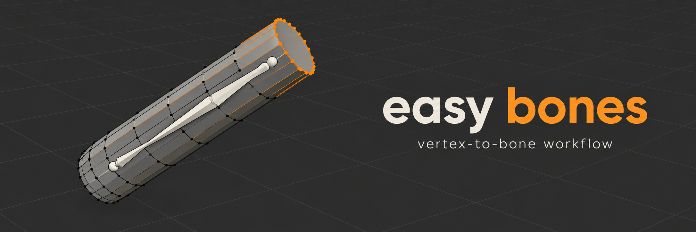

# EasyBones



Blender add-on (5.0+) for placing bones from vertex selections without leaving mesh edit mode.

## Install

Download `easybones_v*.zip` from [Releases](https://github.com/defaultgnome/easybones/releases), then in Blender: Edit > Preferences > Get Extensions > ⌄ > Install from Disk.

## Use

In mesh edit mode, open the sidebar (N) > **Rigging** tab, pick the target armature, then select vertices:

- **New** — new bone, head at the selection center.
- **Head** / **Tail** — move the active bone's head/tail to the selection center. Connected neighbors follow.
- **Extend** — new bone connected to the active bone's tail, tail at the selection center. Name auto-increments (`finger.01.L` -> `finger.02.L`).
- **Span** — bone along the long axis of the selection, end to end (select a cylinder, get a bone through it). Head goes to the lower end, or for a near-horizontal shape the end nearer the armature origin. Target **Active** refits the active bone instead.
- **Flip** — jump to the armature's edit mode and back to the meshes you came from.

**Active** picks the active bone. **Parent** is the parent for new bones (empty = none); the link button applies it to the active bone.

After each op, the Adjust Last Operation panel (bottom left / F9) edits name, parent, roll, and for Span, Invert/Target. **Roll** in the sidebar is the default for each op.

Shortcuts: **Shift+Alt+B** opens the EasyBones pie in mesh edit (Parent… there also re-parents the active bone); in armature edit it flips back. Single ops: Preferences > Keymap > Mesh > `EasyBones ...`, or right-click a button > Assign Shortcut. Sidebar tab name is set in the add-on preferences.

## Develop

```sh
./pack.sh   # -> dist/easybones_v<version>.zip
/Applications/Blender.app/Contents/MacOS/Blender -b --factory-startup --python test_easybones.py
```

## Release

1. Bump `version` in `blender_manifest.toml` and add a `## [x.y.z]` section to `CHANGELOG.md`.
2. Push, then Actions > **release** > Run workflow. It tags `vx.y.z` and publishes a release with the zip and changelog notes.

## License

GPL-3.0-or-later
