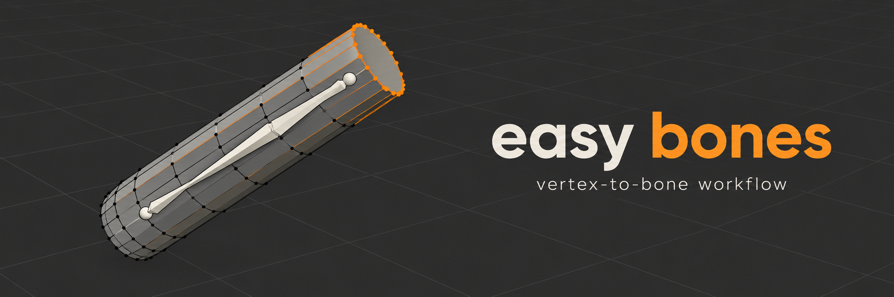

# EasyBones



Blender add-on (5.0+) for placing bones from vertex selections without leaving mesh edit mode.

## Install

Download `easybones_v*.zip` from [Releases](https://github.com/defaultgnome/easybones/releases), then in Blender: Edit > Preferences > Get Extensions > ⌄ > Install from Disk.

## Use

In mesh edit mode, open the sidebar (N) > **Rigging** tab, pick the target armature, then select vertices:

- **New** — new bone, head at the selection center.
- **Head** / **Tail** — move the active bone's head/tail to the selection center. Connected neighbors follow.
- **Move** — move the whole active bone (like G) so its head lands on the selection center; length and direction stay the same. Connected neighbors follow.
- **Extend** — new bone connected to the active bone's tail, tail at the selection center. Name auto-increments (`finger.01.L` -> `finger.02.L`).
- **Span** — bone along the long axis of the selection, end to end (select a cylinder, get a bone through it). Head goes to the lower end, or for a near-horizontal shape the end nearer the armature origin. Target **Active** refits the active bone instead.
- **Flip** — jump to the armature's edit mode and back to the meshes you came from. Also works from pose mode (back to the meshes).

**Active** picks the active bone. New and Span bones are unparented; only Extend parents (connected to the active bone). For any other parenting, Flip to the armature and use Blender's Ctrl+P.

After each op, the Adjust Last Operation panel (bottom left / F9) edits name, and for Span, Invert/Target.

### Bone selection

In mesh edit, armature edit, pose and weight paint mode (sidebar > **Select Bone**):

- **Mirror** — make the active bone's `.L`/`.R` counterpart active. Warns if there is none.
- **Next** / **Prev** — step along the chain. The **Follow** toggle picks how: **Naming** uses the last number in the name (`spine.01` -> `spine.02`, wraps from the last to the first); **Parenting** goes to the first child (Next) or the parent (Prev).

In mesh edit and weight paint only the active bone changes; in armature edit and pose the target becomes the only selected bone. In weight paint the armature is the mesh's Armature modifier object.

### Rig Layers (DEF / ORG)

In armature edit and pose mode the sidebar has **From** and **To** prefix fields (default `DEF` and `ORG`) and a **Selected Only** toggle. Both buttons work from either mode:

- **Clone Layer** — copy every `DEF*` bone to `ORG*` (same position, hierarchy kept, non-deforming) into a bone collection named `ORG`. If any new name already exists, nothing happens.
- **Copy Transform** — add a Copy Transforms constraint to each `DEF*` bone targeting its `ORG*` counterpart. Bones without a counterpart are listed in the console; existing links are skipped.

### Shortcuts

| Key | Where | Does |
| --- | --- | --- |
| `\` | mesh edit, armature edit, pose | Flip |
| `Shift+\` | mesh edit, armature edit, pose, weight paint | Selection pie (Prev / Next / Mirror) |
| `Alt+\` | mesh edit | EasyBones pie (New, Extend, Span, Head, Tail, Move, Flip) |

Everything else is unbound: Preferences > Keymap > Mesh / Armature / Pose / Weight Paint > `EasyBones ...`, or right-click a button > Assign Shortcut. Sidebar tab name is set in the add-on preferences.

## Develop

```sh
./pack.sh   # -> dist/easybones_v<version>.zip
./pack.sh --validate   # also run blender --command extension validate (blender in PATH)
.\pack.ps1 [-Validate]   # Windows (PowerShell) equivalent
/Applications/Blender.app/Contents/MacOS/Blender -b --factory-startup --python test_easybones.py
```

## Release

1. Bump `version` in `blender_manifest.toml` and add a `## [x.y.z]` section to `CHANGELOG.md`.
2. Push, then Actions > **release** > Run workflow. It tags `vx.y.z` and publishes a release with the zip and changelog notes.

### Blender Extensions platform

The release zip is also what you upload to [extensions.blender.org](https://extensions.blender.org):

1. `./pack.sh --validate` (or `.\pack.ps1 -Validate`) and check it passes.
2. Log in, open your profile > **My Extensions** > EasyBones > **Upload new version** and upload `dist/easybones_vx.y.z.zip` (or the zip from the GitHub release). The version must be higher than the published one.
3. The new version goes through review; once approved it shows up as an update in Blender's Get Extensions.

## License

GPL-3.0-or-later
